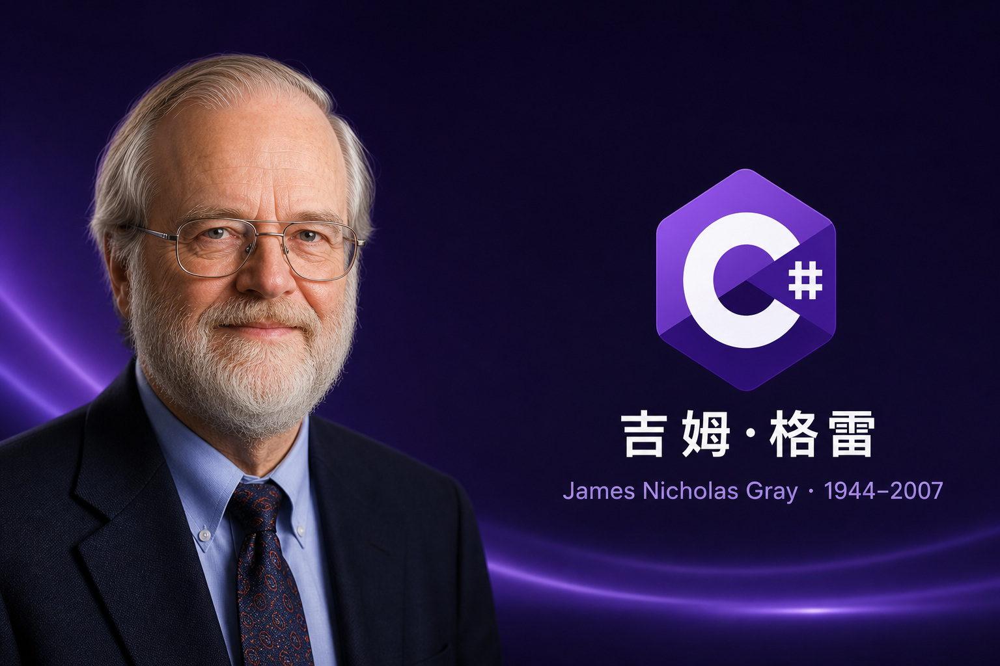

**C# .NET 周刊｜2026年5月4期 2026-05-24 dotnet_week_26_5_4**

## 国内文章

### Dddify：给 ASP.NET Core 项目一套轻量、清晰、可落地的 DDD 基础设施

https://www.cnblogs.com/esofar/p/20078108/dddify

Dddify 是一个面向 ASP.NET Core 的轻量级 DDD 集成框架，旨在平衡样板代码与框架侵入。它基于 MediatR、FluentValidation、Scrutor、Mapster 与 EF Core，推荐 Domain、Application、Infrastructure、Web 四层结构。框架提供聚合根、实体、值对象、领域事件、仓储契约、领域与应用异常，以及审计、软删除与并发支持。应用层用 MediatR 组织命令与查询，内置验证与工作单元管道行为，示例中把不变量维护在领域模型中以保持清晰边界。仓库与文档公开，便于团队快速落地并聚焦业务建模。

### 一个程序员眼中的 AI 核心概念，讲透 LLM 、Agent 、MCP 、Skill 、RAG...

https://www.cnblogs.com/w5942066/p/20126166

文章拆解AI Agent运作。描述Claude Code通过循环发起多次API请求定位并修复代码问题。解释LLM本质为下一个Token的概率预测，并由大量参数产生涌现能力。说明Prompt由背景(Context)和具体指令构成。提出Memory为将历史对话注入上下文以实现多轮交互，并指出记忆会超出上下文窗口，需用记忆压缩处理。强调所有工程化组件都为LLM服务以提高提示信息效率。文中以.NET程序员和Controller示例说明应用场景。

### [对比学习LangChain和MAF-01]基本编程模式的差异(上篇)

https://www.cnblogs.com/artech/p/20089244/lc-maf-01

作者为资深.NET开发者，最初使用Semantic Kernel、AutoGen和MAF，但对MAF设计有保留。为拓展视野，他转向LangChain，通过对比深化对MAF的理解。系列将以LangChain对比方式介绍MAF的编程模式与架构，并以C#演示MAF实现。文中指出对应关系：MAF的ChatClientAgent对应LangChain的Agent，MAF的Session对应Thread，MAF的工作流对应LangGraph。示例使用Azure上部署的gpt-5.2-chat，展示了LangChain用Python创建Agent的代码。作者还比较了环境变量处理差异：LangChain自动加载，MAF需显式配置。文章示例部分中断未完。

### .NET 10 桌面 UI 框架的范式演进：Jalium.UI 与 MewUI 架构深度对比

https://www.cnblogs.com/shanyou/p/20101061

本文比较.NET 桌面生态的两条分化路径：重型的 Jalium.UI 与极简的 MewUI。Jalium.UI 面向高保真场景，采用 GPU 加速、JALXAML 与 Razor 语法融合，并用 Roslyn 源生成在编译期剔除冗余节点以优化内存与冷启动。MewUI 由社区发起，追求无外部 C++ 依赖的极致轻量，目标 NativeAOT 后体积 2.5–4MB。文章剖析渲染管线、状态绑定、标记编译与内存管理，并讨论 .NET 10 的源生成器、栈分配与 SIMD 如何赋能下一代桌面框架。论点具体且具工程参考价值。

### .NET 8 Web开发入门(五)：构建盾牌——数据验证与全局异常处理

https://www.cnblogs.com/shenchuanchao/p/20065649/dotnet-8-web-development-part5-data-validation-global-exception-handling

文章讲述防护“脏数据”的策略。先介绍ASP.NET Core模型绑定与Data Annotations，给出TodoItem示例并用Required和StringLength约束字段。示范在Minimal API中用ValidationContext和Validator.TryValidateObject手动校验请求并返回400错误。作者指出数据注解会使实体臃肿且难以表达复杂规则，推荐采用FluentValidation。文章说明如何安装FluentValidation.AspNetCore并展示创建TodoItemValidator的部分规则。文末关于FluentValidation的示例被截断，未完整展开高级规则和实战用法。

### StarBlog番外(5) 从1.6到1.10，基于Avalonia AOT 开发的 Publisher 半年进化之路

https://www.cnblogs.com/deali/p/20118877

本文总结了半年来 StarBlog Publisher 从 v1.6 到 v1.10.7 的更新。作者强调 AI 能力增强：封面提示词生成、关键词提取和标题优化模板。图片处理升级包括自动压缩(SixLabors.ImageSharp)、画廊和正则图片解析。框架从 .NET 8 升级到 .NET 10，并更新了 Avalonia、CommunityToolkit.Mvvm、Refit 等依赖。新增 Scoop 安装支持和 CI/CD 优化。文章列出版本时间线并得出结论：Publisher 已从“能用”进化为“好用”，AI 为主要驱动力。

### Qt Bridges for C# 深度技术解析

https://www.cnblogs.com/shanyou/p/20135353

Qt Bridges for C# 于 2026-05-20 发布 Public Beta。该方案允许 C# 开发者用 Qt Quick/QML 构建跨平台 UI，无需 C++。架构通过 .NET Hosting API，由 C++ 层加载 CLR，利用 QDotNetHost 与 QDotNetAdapter 实现双向互操作。编译时代码生成 C++ 包装器，运行时接近原生性能。该桥接仅绑定 UI 层，维护成本较全覆盖绑定降低约 80%。当前生态尚处早期，安装依赖 C++ 工具链与 Qt 源码构建，成熟度 3/5。短期内难以在通用桌面击败 Avalonia，但在需官方 Linux 支持、GPU 加速与行业安全认证的汽车、医疗和工业场景具差异化优势。主要风险为 C++ 依赖、LGPLv3 许可和资金压力。建议于 2026 Q3-Q4 开展技术评估。

### 记一次 .NET 某集群管理软件 内存暴涨分析

https://www.cnblogs.com/huangxincheng/p/20119964

文章记录一次内存暴涨排查。作者接到朋友反馈后获取了进程 dump。使用 !address -summary 和 !eeheap -gc 分析托管堆。输出显示大量小对象堆和大对象堆段，单段占用达数百MB。Pinned Object Heap 较小但存在。文章通过段级信息定位内存增长来源，准备进一步分析对象类型与引用链以确认泄漏或碎片问题。

### .NET如何实现向量语义分析

https://www.cnblogs.com/fanliang11/p/20075137

文章描述作者在插件平台和AI Agent集成中遇到的中文语义匹配问题。作者指出LlamaEmbedder非向量模型，中文短句表现差、未做向量归一化和语义对齐，导致余弦相似度异常。作者推荐两种中文向量模型：BGE(最准确)和m3e(轻量快速)。文中提供bge-small-zh的下载链接，并给出基于ONNX的C#实现示例，提示使用Microsoft.ML.OnnxRuntime和Microsoft.ML.Tokenizers并设置会话线程等参数。内容具备较高实用性，能直接复现，但部分技术细节可再补充和验证。

### 从人工同步到自动闭环：跨 Java/.NET 代码转换工具的工程化实践

https://www.cnblogs.com/powertoolsteam/p/20103632

文章描述 GcExcel 同时维护 Java 与 .NET 两套实现，导致同步工作繁重且易出错。作者回顾从对话式 AI 到具备仓库读取和命令执行能力的工具演进，并介绍以 Slash Command、pre-push hook 与图形界面三种自动化尝试。文章指出 hook 配置复杂、维护分散和批量转换稳定性差等痛点，并开始分析上下文膨胀引发的大任务不稳定问题。作者强调 AI 封装流程提升效率，但推广与稳定性仍需改进。

### 架构融合：Activity Host 作为确定性编排与认知智能代理的桥梁

https://www.cnblogs.com/shanyou/p/20066935

文章分析 Elsa Workflows 与 Microsoft Agent Framework 在企业编排中的冲突与融合。它介绍 Activity Host 的设计与实现，指出通过 PR 7172 在 Elsa 3.6.0 用反射将 CLR 类映射为 Elsa Activity。文章强调代码优先范式，允许异步 C# 方法无包装地出现在可视化工作流中，减少样板代码。作者比较 Elsa 的确定性、持久化与可审计特性与 Agent Framework 的多代理非确定性行为。文中基于社区专家与源码变更给出实践与用例分析。该文技术深度高，具备强烈的.NET相关性与实用价值。

### C# 实现 Word 文档文本批量替换 (动态填充)

https://www.cnblogs.com/jazz-z/p/20077796

文章介绍了在企业级场景中使用 Free Spire.Doc for .NET 自动化修改 Word 文档的实用方法。文中说明了通过 NuGet 安装库并引用 Spire.Doc 命名空间。展示了 Document.Replace 的参数与基本用法，给出替换全部和仅替换首次出现的示例代码。强调替换能保留原有格式和排版。文章还提及使用正则表达式重载替换花括号占位符，但示例在末尾被截断未完整展开。

### .NET 8 Web开发入门(六)：Blazor 全栈开发——告别 JavaScript 焦虑

https://www.cnblogs.com/shenchuanchao/p/20135434/dotnet-8-web-development-part6-blazor-full-stack-no-javascript-anxiety

文章由作者码农刚子撰写，旨在为后端开发者介绍用 C# 用 Blazor 替代 JavaScript 的思路。作者阐述全栈痛点，介绍 Blazor 两种托管模型：WebAssembly 在浏览器运行，Server 在服务器通过 SignalR 实时通信。教程选用 Blazor Server，给出调试方便、首屏加载快、适合后台管理的理由。提供了创建项目的命令行和 Visual Studio 步骤，并特别提示 .NET 8 将传统模板合并为 Blazor Web App 并引入交互渲染模式，影响项目创建。文章还解析了项目结构，强调组件化开发，并以计数器组件示例展示基本用法，适合入门参考。

### OpenClaw.NET 兼容性目录指南(Compatibility Catalog)

https://www.cnblogs.com/shanyou/p/20112506

本文详述 OpenClaw.NET 的 compat/public-smoke.json 用途与格式。它定义为兼容性验证的单一事实源，支持嵌入为 OpenClaw.Core 的资源，兼容 NativeAOT，且通过 CLI 与 REST API 暴露。文中给出 JSON 示例，列明通用字段、技能与 NPM 插件专用字段及必填项，并强调 NPM 插件必须声明 expectedStatus。文档结构清晰，实用性强，但末尾内容截断且缺乏引用与示例执行流程。

### AScript异步执行与await关键字

https://www.cnblogs.com/rockey627/p/20111832

AScript是开源C#动态脚本解析执行引擎。自1.2.5起支持异步解析执行，并新增await与@@CancellationToken关键字。Script.EvalAsync可接收CancellationToken并异步执行脚本。解析执行模式实现异步解析且异步执行，脚本内await保持异步。编译执行模式为异步解析、同步编译和同步执行，脚本内await会阻塞等待。推荐使用await，因为异步执行时保持异步，同步执行时等同于.Result，且对非异步方法自动忽略。@@CancellationToken在异步执行时对应EvalAsync传入的CancellationToken，同步执行时为CancellationToken.None。文中含示例并指向AwaitTokenHandler与AwaitFunction实现细节。

### 基于.Net的NetCoreKevin框架中AgentFramework实现AI智能体Skill和工具动态管理和加载

https://www.cnblogs.com/net-kevin-li/p/20121110

本文介绍 NetCoreKevin 框架如何基于自研 AgentFramework 实现 Skill 与 Tool 的数据驱动与文件热加载管理。工具通过 AIFunctionFactory 将 C# 方法封装并注入 ChatOptions.Tools。技能以 .zip 包存储，由 AgentSkillsProviderBuilder 构建为 AIContextProvider 并由 AgentFramework 调度。所有条目保存在 TAISkillToolManagement 实体，IAISkillToolManagementService 管理启用状态、描述与方法绑定等字段。文章详述数据库定义、动态注入流程与自动解压加载实现，并提供完整开源仓库链接以便复现与扩展。

### Avalonia中的动画

https://www.cnblogs.com/xrwang/p/20122560/AnimationInAvalonia

文章介绍Avalonia三种内置动画：关键帧、过渡和合成，并说明它们的适用场景。作者展示了如何实现离散动画，提供了继承InterpolatingAnimator<string>的CustomStringAnimator类用于打字机效果的完整C#实现。文中还给出XAML使用示例和官方链接，便于实践和参考。内容技术性适中、实用且有引用，但示例部分末尾被截断。

### 用户自定义配置管理最佳实践

https://www.cnblogs.com/newbe36524/p/20085899

文章分享 HagiCode 的用户自定义配置管理实践。系统采用前端(React+Redux)、应用服务、领域配置存储和基础设施四层架构，职责清晰且易于测试和扩展。方案关注版本管理、向后兼容、数据验证、并发控制和功能门控，基础设施以 YAML 存储并用 SemaphoreSlim 控制并发，提供密钥管理接口。文中展示了后端核心接口 IFrontendConfigStore 的设计思路并附上项目地址。总体偏工程实用，但实现细节与示例不足。

---

## 国际周报

**国际周报未更新**

## 今日人物

**詹姆斯·尼古拉·格雷**(英语：James Nicholas "Jim" Gray，1944年1月12日—2007年1月28日失踪)，美国计算机科学家，数据库与事务处理领域的先驱。他参与 IBM System R 等系统的研发，在事务、并发控制、崩溃恢复、容错和性能基准方面作出重要贡献，并推动相关理论进入大规模商业系统。

1998年，格雷因“对数据库和事务处理研究的开创性贡献，以及在系统实现中的技术领导地位”获得图灵奖。

## C# .NET 交流群

相信大家在开发中经常会遇到一些性能问题，苦于没有有效的工具去发现性能瓶颈，或者是发现瓶颈以后不知道该如何优化。之前一直有读者朋友询问有没有技术交流群，但是由于各种原因一直都没创建，现在很高兴的在这里宣布，我创建了一个专门交流.NET 性能优化经验的群组，主题包括但不限于：

- 如何找到.NET 性能瓶颈，如使用 APM、dotnet tools 等工具
- .NET 框架底层原理的实现，如垃圾回收器、JIT 等等
- 如何编写高性能的.NET 代码，哪些地方存在性能陷阱

希望能有更多志同道合朋友加入，分享一些工作中遇到的.NET 问题和宝贵的分析优化经验。**目前一群已满，现在开放二群。**可以加我 vx，我拉你进群: **ls1075** 另外也创建了 **QQ Group**: 687779078，欢迎大家加入。
