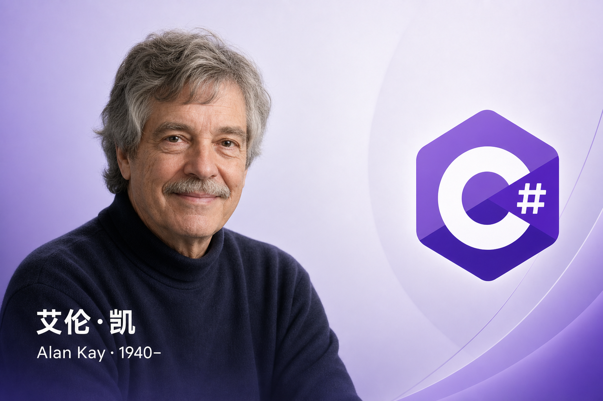

**C# .NET 周刊｜2026年6月4期 2026-06-28 dotnet_week_26_6_4**

## 国内文章
### 用 OllamaHub  让 Visual Studio Copilot 可以对接任意模型

https://www.cnblogs.com/lindexi/p/20687205

文章介绍开源项目 OllamaHub(https://github.com/mingkuang-Chuyu/OllamaHub)，建议为账号安全自行部署。项目为纯 C#，无需 Ollama 依赖，模拟 Ollama 协议以连接 Visual Studio Copilot 与第三方模型。拉取后可用 dotnet run 启动，但需先更新 Visual Studio(含 .NET 10)。在输出目录 bin\Debug\net10.0 新建 settings.json 并填写示例配置，示例演示如何添加兼容 OpenAI 的 providers 与 models(示例为 DeepSeek)，并提示替换为自己的 API Key。文章还推荐 DeepSeek 的性价比和易用性。

### 一行代码抓遍全网 20 个热榜！Aneiang.Pa 4.0 发布 — 极简 .NET 爬虫库

https://www.cnblogs.com/cacocode/p/20720777

本文介绍 Aneiang.Pa 4.0，一个面向抓取平台热榜的 .NET 库。它支持一行启动 Pa.Source("WeiBo").GetAsync() 并返回结构化数据。库内置 20 个平台，支持强类型映射、HttpClient 管理、UA 轮换、指数退避重试、内存缓存、熔断、结构化日志、Prometheus 指标与 OpenTelemetry。新增平台只需编写一份 YAML 即可扩展。文中提供示例代码与平台列表，目标是避免重复编写爬虫，提高开发效率。

### C#/.NET/.NET Core优秀项目和框架2026年5月简报

https://www.cnblogs.com/Can-daydayup/p/20698093

本文为每月C#/.NET精选项目汇总，推文包含项目功能、使用方法、截图与源码链接。推荐项目包括 Winhance(Windows 系统增强)、FluentAvalonia(基于 Fluent 的 Avalonia 控件库)、CommunityToolkit.Mvvm(微软维护的 MVVM 工具包)、Prism(XAML 应用框架)、ReactiveUI(响应式 MVVM 框架)和 Caliburn.Micro 等。文章提供 GitHub/Gitee 源码地址及公众号获取详细介绍，侧重实践工具推荐，便于开发者快速查找与使用开源项目。

### 使用 PublishAotClang 轻松交叉编译 Linux Native AOT

https://www.cnblogs.com/kewei/p/20887495

文章介绍 PublishAotClang，这是一个将 Zig 封装为 Clang 工具链的 NuGet 包，帮助在 Windows 上把 .NET 项目 AOT 发布到多种 Linux RID。它内置 Zig 工具链，无需安装或配置 PATH，支持 strip 减小二进制体积，并内置 zlib 静态库。用户可指定 glibc 版本以兼容旧系统。作者用 C# 重写 clang 包装器并新增 ar 包装器，解决跨操作系统与跨架构链接问题。该工具只影响链接阶段，不改变 IL→目标文件的编译流程，生成的 ELF 与原生编译性能相同。项目在 GitHub 上公开。

### C# ?? 链式回退：编写优雅的多级兜底逻辑

https://www.cnblogs.com/shanyou/p/20854707

文章介绍 C# 的 ?? 空合并运算符及其链式用法，说明编译器右结合和短路求值。以 OpenClaw.NET 的 AdminEndpoints.cs 实例拆解三级回退链。优先使用 runtime.Operations.ModelProfiles as ConfiguredModelProfileRegistry，其次复用已解析的 modelProfiles as ConfiguredModelProfileRegistry，最后以 ConfiguredModelProfileRegistry.CreateInitialized(startup.Config) 兜底。作者强调复用实例可避免重复调用 CreateInitialized，从而防止为每个模型重复创建 IChatClient、浪费内存和产生资源泄漏。示例清晰，实践性强，强调用 as 与链式 ?? 实现高效、安全的回退逻辑。

### Claude Code Dynamic Workflows vs OpenClaw.NET MetaSKILL

https://www.cnblogs.com/shanyou/p/20876713

本文比较两种编排范式：Claude Code Dynamic Workflows 用可执行 JavaScript 在会话内驱动多 Agent 协作，提供 agent(), pipeline(), parallel(), phase(), 实时日志、预算感知与 worktree 隔离。OpenClaw.NET MetaSKILL 采用 YAML 声明式 DAG，由 .NET 运行时在 Gateway 进程调度，支持 fan_out 并发、依赖声明与模板化指令。设计分为“代码即编排”与“声明即编排”。运行环境分别为 Node.js 沙箱与 OpenClaw.NET 服务器。触发方式包含 /workflow、工具触发和 meta_invoke。总结清晰对比实现细节与适用场景。

### 将 Rust 绑定到 .NET 10：Oxigraph 的 FFI 桥接实践

https://www.cnblogs.com/shanyou/p/20884135

文章说明如何通过 FFI 将 Rust 编写的高性能图数据库 Oxigraph 绑定到 .NET 10，覆盖工具链设计、数据协议、内存管理、回调机制与构建流水线。文中给出架构图，明确 .NET 应用层、Interop 层与 Rust cdylib 的职责分工。列举 ffi.rs、stream_ffi.rs、error.rs、model_ffi.rs 等模块，说明 Store CRUD、SPARQL、流式 I/O、懒查询迭代器、分块批量加载、查询结果序列化和自定义函数实现。实现基于 P/Invoke 的 JSON 协议，并使用 SafeHandle 与回调封装托管互操作。技术深度和实用性强，但缺少引用且部分文本含 HTML 转义影响可读性。

### C# 解析 Word 超链接：字段识别、屏幕提示读取

https://www.cnblogs.com/jazz-z/p/20721494

本文面向.NET开发者，基于 Free Spire.Doc 介绍从 Word 提取超链接的轻量实现。文章列出加载文档、遍历节和段落、识别 Field 并筛选 FieldHyperlink 的基本流程。文中给出完整 C# 示例代码，并说明如何通过 NuGet 安装与引用命名空间。文章提示免费版页数限制，但末尾关于屏幕提示的说明被截断，未详述字段代码解析和异常处理等进阶细节。整体实用且易上手，但在技术深度、扩展性和引用方面仍有提升空间。

### [MAF预定义的AIContextProvider-04]Mem0Provider——长期记忆基于的云端解决方案

https://www.cnblogs.com/artech/p/20687121/ai-context-provider-04

本文介绍用Mem0Provider为Agent实现长期记忆。作者对比了基于向量库的ChatHistoryMemoryProvider与Mem0和Azure Foundry的预定义Provider。Mem0采用向量与图谱混合架构，支持跨会话记忆并提供试用API-Key。作者因NuGet未发布从GitHub获取实现，并提醒未来包发布后API可能变化。示例展示通过HttpClient连接https://api.mem0.ai，并在Authorization头加入Token类型的MEM0_API_KEY来创建Mem0Provider。作者在点餐Agent中用Mem0替换ChatHistoryMemoryProvider以保存用户偏好。文章实用且及时，但技术深度和引用不足。

### Roslyn语法的模式匹配之EasySyntax增加模式匹配支持

https://www.cnblogs.com/xiangji/p/20691808

文章以一行检测回文的C#模式匹配示例开场，展示逻辑、列表、var和切片等多种模式。作者列出十二种模式类型并说明is、switch语句与switch表达式支持模式匹配。文章演示了使用EasySyntax扩展和Roslyn SyntaxFactory生成类型模式的实现，强调SourceGenerator需支持模式匹配并介绍EasySyntax已扩展相关支持。示例具体且面向实用，但部分段落不完整，引用了一条微软文档链接。

### HagiCode 是怎么把 13 个 Agent CLI 接到一套系统里的

https://www.cnblogs.com/newbe36524/p/20711739

HagiCode 通过分层架构把多种风格的 Agent CLI 统一管理。它以 AIProviderType 枚举作为每个 CLI 的身份证，并用 ToStringValue()/ToAIProviderType() 做互转。业务层只依赖 IAIProvider/IAIProviderFactory 接口，屏蔽底层实现细节。适配器层负责各 CLI 的协议差异，工厂中显式抛出 NotSupportedException 屏蔽已废弃的 IFlowCli，最终系统实际支持 13 个 provider(如 Claude、Codex、Copilot、Gemini 等)。该设计旨在消除业务代码中的大量 if 分支，便于接入新 CLI。文章缺少完整实现细节和引用。

### 【EF Core】级联删除行为

https://www.cnblogs.com/tcjiaan/p/20875517

文章介绍 Microsoft.EntityFrameworkCore.DeleteBehavior 枚举。说明该枚举控制当被依赖实体被删除时，从实体中外键的处理方式。枚举分两组：以 Client 开头的由 EF Core 在客户端处理级联删除，适用于数据库只建表不定义关系的情况；非 Client 成员在数据库层定义外键约束，常见于 Code First 或 DB First。作者偏好把删除逻辑放在程序端，并以 SQL Server 给出建表示例(示例未完)。文中夹杂 AI 生成代码和 C 语言内存错误的经验教训，提醒勿盲目信任生成代码。

### Slickflow.MCP-Server-工作流引擎接入AI编排平台实践

https://www.cnblogs.com/slickflow/p/20772623

本文介绍将 Slickflow 工作流引擎封装为基于 .NET 8 的 MCP Server，支持 Dify、Coze、n8n、Claude 等 AI 编排平台通过 Model Context Protocol 调用。服务基于 ModelContextProtocol.AspNetCore v0.3.0-preview.2，运行在 5100 端口，提供 14 个工具(12 个 WorkflowTools 和 2 个 KnowledgeBaseTools)。架构中 Slickflow 使用 PostgreSQL 存储，向量检索采用 PgVector 和 text-embedding-v4/1536d 嵌入。通过 MCP，AI Agent 可自主启动和推进流程、查询状态并联动知识库，避免为每个 LLM 平台重复适配。文章列出主要工具接口及典型参数，但部分实现细节未完全展开。

---

## 国际周报

## 话题

### 智能终端 0.1.1 来了：支持bash，新增斜杠命令，以及更多自定义功能——Windows 命令 线路
https://devblogs.microsoft.com/commandline/intelligent-terminal-0-1-1-is-here-bash-support-new-slash-commands-and-customization/

### GitHub Actions 检查更安全的pull_request_target默认值 - GitHub 更新日志
https://github.blog/changelog/2026-06-18-safer-pull_request_target-defaults-for-github-actions-checkout/

## 精选
### Kaigi 2026 in C# 招标(讨论)现已开放
https://fortee.jp/csharpkaigi-2026/speaker/proposal/cfp

我们现正接受[C# Kaigi 2026](https://csharpkaigi.net/)的提案征集(CfP)，该活动将于2026年9月19日星期六在台场的docomo R&D OPEN LAB举行。 直到2026年7月5日星期日。

## 发布
- [AvaloniaUI/Avalonia](https://github.com/AvaloniaUI/Avalonia)
    - [2018年3月11日](https://github.com/AvaloniaUI/Avalonia/releases/tag/11.3.18)，[12.0.5](https://github.com/AvaloniaUI/Avalonia/releases/tag/12.0.5)
- [aws/aws-sdk-net](https://github.com/aws/aws-sdk-net)
    - [4.0.273.0](https://github.com/aws/aws-sdk-net/releases/tag/4.0.273.0)，[4.0.274.0](https://github.com/aws/aws-sdk-net/releases/tag/4.0.274.0)，[4.0.275。 0](https://github.com/aws/aws-sdk-net/releases/tag/4.0.275.0)， [4.0.275.1](https://github.com/aws/aws-sdk-net/releases/tag/4.0.275.1)， [4.0.276.0](https://github.com/aws/aws-sdk-net/releases/tag/4.0.276.0)
- [Azure/azure-sdk-for-net](https://github.com/Azure/azure-sdk-for-net)
    - [Azure.Communication.CallAutomation_1.6.0](https://github.com/Azure/azure-sdk-for-net/releases/tag/Azure.Communication.CallAutomation_1.6.0)， [ Azure.Data.AppConfiguration_1.10.0](https://github.com/Azure/azure-sdk-for-net/releases/tag/Azure.Data.AppConfiguration_1.10.0)， [ Azure.ResourceManager.Compute.BulkActions_1.0.0](https://github.com/Azure/azure-sdk-for-net/releases/tag/Azure.ResourceManager.Compute.BulkActions_1.0.0)， [ Azure.ResourceManager.ComputeLimit_1.2.0](https://github.com/Azure/azure-sdk-for-net/releases/tag/Azure.ResourceManager.ComputeLimit_1.2.0)， [ Azure.ResourceManager.Network_1.16.0](https://github.com/Azure/azure-sdk-for-net/releases/tag/Azure.ResourceManager.Network_1.16.0)， [Azure.ResourceManager.Qumulo_1.3. 0](https://github.com/Azure/azure-sdk-for-net/releases/tag/Azure.ResourceManager.Qumulo_1.3.0)， [Azure.Storage.Blobs_12.29。 1](https://github.com/Azure/azure-sdk-for-net/releases/tag/Azure.Storage.Blobs_12.29.1)，[Azure.Storage.Files.DataLake_12.27。 1](https://github.com/Azure/azure-sdk-for-net/releases/tag/Azure.Storage.Files.DataLake_12.27.1)，[Azure.Storage.Files.Shares_12.27。 1](https://github.com/Azure/azure-sdk-for-net/releases/tag/Azure.Storage.Files.Shares_12.27.1)，[Azure.Storage.Queues_12.27。 1](https://github.com/Azure/azure-sdk-for-net/releases/tag/Azure.Storage.Queues_12.27.1)
- [DataDog/dd-trace-dotnet](https://github.com/DataDog/dd-trace-dotnet)
    - [v3.47.0](https://github.com/DataDog/dd-trace-dotnet/releases/tag/v3.47.0)
- [domaindrivendev/Swashbuckle.AspNetCore](https://github.com/domaindrivendev/Swashbuckle.AspNetCore)
    - [v10.2.2](https://github.com/domaindrivendev/Swashbuckle.AspNetCore/releases/tag/v10.2.2)， [v10.2.3](https://github.com/domaindrivendev/Swashbuckle.AspNetCore/releases/tag/v10.2.3)
- [dotnet/maui](https://github.com/dotnet/maui)
    - [10.0.80](https://github.com/dotnet/maui/releases/tag/10.0.80)
- [dotnet/Orleans](https://github.com/dotnet/orleans)
    - [v10.2.1](https://github.com/dotnet/orleans/releases/tag/v10.2.1)
- [dotnet/反应式](https://github.com/dotnet/reactive)
    - [rxnet-v7.0.0-rc.1](https://github.com/dotnet/reactive/releases/tag/rxnet-v7.0.0-rc.1)
- [dotnet/SqlClient](https://github.com/dotnet/SqlClient)
    - [v7.0.2](https://github.com/dotnet/SqlClient/releases/tag/v7.0.2)
- [googleapis/google-cloud-dotnet](https://github.com/googleapis/google-cloud-dotnet)
    - [Google.Cloud.Dataproc.V1-5.27.0](https://github.com/googleapis/google-cloud-dotnet/releases/tag/Google.Cloud.Dataproc.V1-5.27.0)， [Google.Cloud.Dialogflow.V2-4.30。 0](https://github.com/googleapis/google-cloud-dotnet/releases/tag/Google.Cloud.Dialogflow.V2-4.30.0)， [Google.Cloud.NetworkManagement.V1-2.20. 0](https://github.com/googleapis/google-cloud-dotnet/releases/tag/Google.Cloud.NetworkManagement.V1-2.20.0)， [Google.Cloud.NetworkServices.V1-1.6. 0](https://github.com/googleapis/google-cloud-dotnet/releases/tag/Google.Cloud.NetworkServices.V1-1.6.0)， [Google.Cloud.OracleDatabase.V1-1.7. 0](https://github.com/googleapis/google-cloud-dotnet/releases/tag/Google.Cloud.OracleDatabase.V1-1.7.0)， [Google.Cloud.Tools.SecretManagerHelper-0.1. 0](https://github.com/googleapis/google-cloud-dotnet/releases/tag/Google.Cloud.Tools.SecretManagerHelper-0.1.0)
- [微软/Aspire](https://github.com/microsoft/aspire)
    - [v13.4.6](https://github.com/microsoft/aspire/releases/tag/v13.4.6)- [microsoft/CsWin32](https://github.com/microsoft/CsWin32)
    - [v0.3.298](https://github.com/microsoft/CsWin32/releases/tag/v0.3.298)
- [mysql-net/MySqlConnector](https://github.com/mysql-net/MySqlConnector)
    - [2.6.1](https://github.com/mysql-net/MySqlConnector/releases/tag/2.6.1)
- [newrelic/newrelic-dotnet-agent](https://github.com/newrelic/newrelic-dotnet-agent)
    - [v10.52.0](https://github.com/newrelic/newrelic-dotnet-agent/releases/tag/v10.52.0)
- [开放遥测/开放遥测点网贡献](https://github.com/open-telemetry/opentelemetry-dotnet-contrib)
    - [Instrumentation.AWS-1.16.0](https://github.com/open-telemetry/opentelemetry-dotnet-contrib/releases/tag/Instrumentation.AWS-1.16.0)， [Instrumentation.Http-1.16. 0](https://github.com/open-telemetry/opentelemetry-dotnet-contrib/releases/tag/Instrumentation.Http-1.16.0)， [Instrumentation.SqlClient-1.16. 0](https://github.com/open-telemetry/opentelemetry-dotnet-contrib/releases/tag/Instrumentation.SqlClient-1.16.0)
- [spectreconsole/spectre.console](https://github.com/spectreconsole/spectre.console)
    - [0.57.1](https://github.com/spectreconsole/spectre.console/releases/tag/0.57.1)
- [StackExchange/StackExchange.Redis](https://github.com/StackExchange/StackExchange.Redis)
    - [3.0.7](https://github.com/StackExchange/StackExchange.Redis/releases/tag/3.0.7)

## 文物、幻灯片等
### 新台词不仅仅是\r和\n——杰拉尔·巴雷
https://www.meziantou.net/new-lines-are-more-than-r-and-n.htm

### Avalonia UI菜单中的多项选择题 - Qita
https://qiita.com/mifumi323/items/d74129f020a2ee0269e8

### 用 DuckDB 在 C# 中分析了 1.3GB 的 CSV 大约快了 12 倍
https://zenn.dev/sitio1/articles/f844f855425e72

### 在每个显示器的DPI环境中恢复窗口位置 - Qiita
https://qiita.com/Cladophlebis/items/b5cf1d3f2ac894fe381f

### 用 .NET 10 替代 Electron：编写一个零延迟、SIMD 加速的集成开发环境
https://dev.to/iancowley/replacing-electron-with-net-10-writing-a-zero-latency-simd-accelerated-ide-322j

### 为什么WinForms的一位工程师在设计Blazor网页应用时毫不犹豫
https://zenn.dev/jodycraft/articles/eac2865d54b0d4

### 把 ASP.NET 核心放进IIS后，我得到了500——一组三点的AppPool专用、SQL权限和数据保护
https://zenn.dev/harness/articles/iis-aspnet-core-apppool-data-protection

### 避免使用 StringBuilder.MoveChunk 进行 ToString() 分配：探索 .NET 11 预览版 - 部分 3
https://andrewlock.net/exploring-the-dotnet-11-preview-3-avoiding-tostring-allocations-with-stringbuilder-movechunks/

### ASP.NET 在核心身份中设置锁定结束 Left Cookies - Qiita
https://qiita.com/harnesswinner/items/1bee38e9cabc8a56e82f

### 尝试使用带有本地LLM的Microsoft代理框架 第15部分(持久代理)
https://zenn.dev/yy7613/articles/1f01f64055a699

### neue cc - C# Kaigi 2026主题演讲！ 而且...... NET for Android 和 Vibe 编码
https://neue.cc/2026/06/24_superdotnetnew.html

### 你的AI代理总是错过真正的瓶颈。 JetBrains 骑手现在可以修好了。 - JetBrains博客
https://blog.jetbrains.com/dotnet/2026/06/25/performance-profiling-agent-skill-in-rider/

### 我用纯C#做了一个可插入式的Ollama替代品——没有llama.cpp，没有本地双人组，只有ILGPU 核
https://dev.to/lostbeard/i-built-a-drop-in-ollama-replacement-in-pure-c-no-llamacpp-no-native-binaries-just-ilgpu-37o1

### 使用 .NET Native AOT 创建原生库
https://zenn.dev/asus4/articles/b65b2821f5dcf8

### Microsoft 代理框架中的代理技能介绍——从 C# 学习实现模式示例
https://zenn.dev/normalian/articles/agentframework-agentskill-01

### 不要让Microsoft全包
https://www.boxofcables.dev/dont-ask-microsoft-to-do-it-all/

### 点莫滕 | 基于文件的 WinUI 应用，配合 Microsoft.UI.Reactor
https://xaml.dev/post/file-based-winui-apps-with-microsoft-ui-reactor

### 近期源生成器开发 - Qiita
https://qiita.com/ikuzak/items/46fecf3136c53ff4da9c

### C# 与 C++ 互操作性 - cho-dotnetnew
https://speakerdeck.com/harukasao/c-number-and-c-plus-plus-interoperability-cho-dotnetnew

## 库、仓库、工具等
### GaTTGeng/HelmSharp：管理型Helm 兼容图表渲染和Kubernetes 发布的.NET工作流。
https://github.com/GaTTGeng/HelmSharp

- [HelmSharp：无需付费使用 Helm 即可从 .NET 渲染 Helm 图表](https://dev.to/gatt_geng_ce6a8f5b3886c67/helmsharp-render-helm-charts-from-net-without-shelling-out-to-helm-1gng)

---

## 今日人物

**艾伦·凯**(英语：Alan Curtis Kay，1940年5月17日—)，美国计算机科学家、面向对象编程与个人计算先驱。他领导开发 Smalltalk，推动图形用户界面、Dynabook 概念和以儿童为中心的计算机教育，对现代个人计算产生了深远影响。

2003年，凯因“开创现代面向对象编程语言的多项基础思想，领导 Smalltalk 开发，并对个人计算作出根本性贡献”获得图灵奖。

## C# .NET 交流群

相信大家在开发中经常会遇到一些性能问题，苦于没有有效的工具去发现性能瓶颈，或者是发现瓶颈以后不知道该如何优化。之前一直有读者朋友询问有没有技术交流群，但是由于各种原因一直都没创建，现在很高兴的在这里宣布，我创建了一个专门交流.NET 性能优化经验的群组，主题包括但不限于：

- 如何找到.NET 性能瓶颈，如使用 APM、dotnet tools 等工具
- .NET 框架底层原理的实现，如垃圾回收器、JIT 等等
- 如何编写高性能的.NET 代码，哪些地方存在性能陷阱

希望能有更多志同道合朋友加入，分享一些工作中遇到的.NET 问题和宝贵的分析优化经验。**目前一群已满，现在开放二群。**可以加我 vx，我拉你进群: **ls1075** 另外也创建了 **QQ Group**: 687779078，欢迎大家加入。
