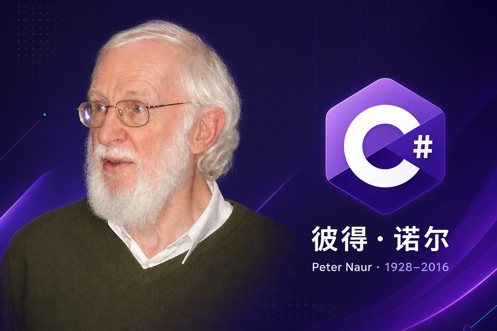

**C# .NET 周刊｜2026年7月2期 2026-07-12 dotnet_week_26_7_2**

## 国内文章

### .NET 10 File-Based Apps：一个 .cs 文件搞定一切，C# 终于也能像 Python 一样写脚本了！

https://www.cnblogs.com/shanyou/p/21227428

文章介绍 .NET 10 的 File-Based Apps 特性。它允许单个 .cs 文件直接运行和发布，并用 #: 指令在源文件中声明配置和 NuGet 依赖。示例展示 hello.cs 和 sqlite-demo.cs，并列出零配置、内嵌配置、默认启用 Native AOT、自动打包为工具及可转换为完整项目等优点。文中给出环境要求和运行命令，实用性强但缺乏底层实现细节与参考文献。

### G#：当 Go、Kotlin 与 Swift 的美学遇见 .NET 运行时

https://www.cnblogs.com/shanyou/p/21346550

文章讨论为何需要另一门 .NET 语言。作者指出 C# 的仪式感和历史积累增加入门门槛。介绍 David Obando 于 2026 年 5 月发起的 G# 项目。G# 用更精简的语法示例对比 C#，将 Hello World 从多行缩至 6 行。G# 编译器 gsc 将代码编译为 IL，输出与 C# 相同的 PE 和在相同 CLR 上运行的程序集。项目在数月内迭代到 v0.3.8，合并 242 个 PR，新增约 12 万行代码。G# 目标是吸引熟悉 Go、Kotlin、Swift 的开发者共享 .NET 生态，而非取代 C#。

### .NET热门ORM真实的性能测试总结

https://www.cnblogs.com/hubro/p/21191221

文章在 .NET 6 环境下使用 BenchmarkDotNet 和 SQLite 对多种 ORM(Chloe、Dapper、FreeSql、EF Core、SqlSugar、linq2db 等)进行了微基准测试。作者解释了选用 BenchmarkDotNet 与 SQLite 的理由并强调多次采样与预热的重要性。测试关注耗时与内存分配，示例为表达式解析场景，结果显示 Chloe 在该项测试中优于 EF Core。文章实用且及时，但报告格式有部分残缺，引用与复现步骤不足，统计细节可进一步完善。

### 从 Bun 的 Rust 重写，看 C# 如何重建 AI 基础设施层

https://www.cnblogs.com/shanyou/p/21309486

核心观点：Bun 用 Rust 重写 JS 运行时，证明编译型语言重建基础设施层的必然性。同理，C# 与 Python 的 AI 生态正出现类似迁移。证据显示 TensorSharp 在 Qwen Image Edit 2511 基准上超越 stable-diffusion.cpp，表明纯 C# 推理引擎已能接近或超越 C++ 性能并具备全生命周期管理能力。文章分析了 Bun 的内存安全痛点与 Rust 借用检查的根本优势，并将其映射到 Python 的 GIL 与动态类型瓶颈。提出在 OpenClaw.NET 上增设 MetaSkill DAG 的 Taste 审核节点，将事后审查演进为事中拦截。该设计为提案，尚未实现。

### 教你如何在Windows下AOT发布Linux下运行的桌面应用程序

https://www.cnblogs.com/wdw984/p/21258724

文章解释AOT概念并详述.NET 8/9/10在原生AOT上的改进，包括ASP.NET Core支持、冷启动、内存优化、PGO、IL链接器、指令集与容器场景。文章阐明AOT带来的安全性提升、独立可执行简化部署与性能收益，并指出在国产化替代中的应用价值。内容技术性强、实用且及时。文章存在拼写与格式错误，缺少引用，部分数据和表述略显夸张，最后章节未完结，影响可读性与可信度。建议补充来源、修正错误并完善未完成段落以提升质量。

### C# vs Go：Agentic 时代的语言分层

https://www.cnblogs.com/shanyou/p/21368348

文章比较Go与C#在Agentic AI时代的适配性。作者承认Go在编译速度、依赖确定性、二进制部署、语言简洁与生态稳定性上的优势。文章指出C#在领域建模、Agent协议层与微软生态(MAF、Semantic Kernel/AutoGen)上的不可替代性。论证有技术深度且具实用导向，逻辑清晰，时效性强。文章可读性良好但引用与实证数据有限，部分结论依赖微软生态假设。

### 当 GIS 开发遇上 .NET：一个 GDAL 集成工具库的架构设计与实践

https://www.cnblogs.com/znlgis/p/21351056

文章介绍在 .NET 平台封装 GDAL 的设计与实践。OGU4Net 是从 Java 移植的 C# 库，目标统一图层模型，屏蔽底层格式差异。作者指出直接使用 GDAL 存在 API 不统一、格式差异暴露和非托管资源管理等问题。项目通过抽象层和统一的 OguLayer 将所有数据映射为 WKT 几何字符串以解耦依赖。为减少 WKT 转换开销，提供了 GeometryUtil 等便捷方法。还设计了 GisEngine 抽象和 GisEngineFactory，当前以 GdalEngine 单例实现，留有扩展点。

### .NET 程序保护实战系列 07 · JIT Hook 保护：在编译时刻解密

https://www.cnblogs.com/gsyifan/p/21271945

文章介绍一种针对 .NET Framework 4.5+ 的 JIT Hook 保护方案。作者通过替换 clrjit.dll 导出的 ICorJitCompiler 的 vtable[0](compileMethod)，在方法被 JIT 编译时解密并恢复真实 IL。实现流程包括加载 clrjit.dll、调用 getJit 获取编译器指针、读取原始 compileMethod、在可执行内存中创建 trampoline 并替换 vtable。方案用 7 字节哨兵 IL 携带方法索引，区分 x86 与 x64 实现，讨论方法数据加密与兼容性，并指出 .NET Core/.NET 5+ 不适用。示例代码部分被截断，但技术细节较为到位。

### .NET 程序保护实战系列 05 · 代码虚拟化

https://www.cnblogs.com/gsyifan/p/21189273

文章介绍将 IL 转换为自定义 VM 字节码以保护 .NET 程序。对比了方法体加密与代码虚拟化的原理、性能差异和适用场景。阐述了从提取 IL、local 签名与异常表，到为 token 构建名称反射实体、序列化为字节码并用 LCG 加密，再以 ManifestResource 存储和用 stub 调用 VirtualMachine.Invoke 的完整流程。说明了栈式解释器的运行时模型及约 50-100 倍的性能开销。列出不适合虚拟化的指令和方法类型，并支持按名选择要虚拟化的方法。文档架构清晰且实用，但缺少完整示例与引用细节。

### BeaverX Admin：一套真正能跑起来的开源管理后台

https://www.cnblogs.com/crackerworkcn/p/21175254

BeaverX Admin 是一套可直接二开的开源前后端管理后台。后端基于 .NET 10 与 EF Core，支持 PostgreSQL 和 MySQL，提供服务端菜单、目录/菜单/按钮三级 RBAC、SignalR 实时推送、Hangfire 定时任务、CAP 异步导出与多节点部署指引。前端采用 Vue 3 + TypeScript + Arco Design，支持动态路由和权限对齐。项目含完整教程、在线演示与默认账号，适合学习、团队内训与快速交付原型。

### Magicodes.IE.IO：零依赖、流式低分配的 .NET Excel 读写库

https://www.cnblogs.com/yyfh/p/21386747

文章介绍 Magicodes.IE.IO，一个零运行时依赖的 .NET Excel 流式读写库。它强调零依赖、流式低内存、完整异步、正确性优先和多 TFM 及 AOT 支持。性能数据展示同步写入固定约72KB内存开销，ToBytes 会随数据线性增长。库支持 IEnumerable 和 IAsyncEnumerable 的流式读写，便于与 EF Core 集成。文章提供上手示例、与其它库对比、高级功能速览和迁移指南。优点是设计明确、适合库作者和大数据场景。缺点是示例有截断，引用和实现细节不够完整。总体信息实用且有价值。

### .NET CORE认证模块-注册方案与请求认证探究

https://www.cnblogs.com/yuxl01/p/21125480

文章细致剖析了 .NET Core 认证注册流程。作者逐条解释了 AddAuthentication 的实现与核心组件：AddAuthenticationCore、AddDataProtection、IAuthenticationConfigurationProvider、ISystemClock、AddWebEncoders。文中包含关键代码片段并说明基于 .NET 7，技术深度足以帮助读者理解内部机制。实践性强，可指导实际配置与调试。表达清晰、结构逻辑性好，但缺少外部源码链接与参考文献。原创性偏向官方源码解读。总体及时且可读性高。

### 给 AI 程序员开「外挂」？这个仓库装了 63 个

https://www.cnblogs.com/znlgis/p/21154437

作者指出大模型在专业领域常产生错误。项目 opengis-skills 在 GitHub 上收集了 63 个工具的 SKILL.md，覆盖 GIS、CAD、C#/.NET 等七大领域。每个 SKILL.md 包含安装说明、核心 API、典型工作流、踩坑指南和 FAQ。使用方法是让 AI 按需加载相关技能文件，通常只读 1~3 个文档即可给出准确答案。项目兼容多种 AI 编程工具，并在 znlgis.github.io 提供图文博客。该方案无需模型微调或向量库，便于用高质量领域文档提升 AI 专业表现。仓库 MIT 许可。

### .NET 程序保护实战系列01-流水线架构与保护引擎总览

https://www.cnblogs.com/gsyifan/p/21161614

该系列基于 TWSoft.AssemblyProtector，系统讲解 .NET 程序集防护。文章覆盖三阶段流水线架构、字符串加密、符号混淆、控制流混淆、代码虚拟化、方法体与 JIT 解密、防篡改、反调试、资源加密、类型注入与授权集成等实现细节。技术栈包括 dnlib、CIL、C# Expression Trees 与 ILGenerator。面向有 IL 基础的 .NET 开发者与安全研究员，强调无外部 DLL 依赖与共享 ProtectionContext。内容详实实用，引用略少，仅供合法学习使用。

### .NET 程序保护实战系列 06 · 方法体加密：密钥在手才能执行的代码

https://www.cnblogs.com/gsyifan/p/21238964

文章介绍方法体加密的整体架构与关键实现。它指出 IL 以明文存放的问题，并提出提取 IL、序列化为自研 ILED、加密嵌入资源、用 stub 调用 MethodGuard 在运行时解密并通过 DynamicMethod 重建执行的流程。文中详述参数打包、Token 解析、异常处理器和 ldstr 的特殊处理，以及缓存和性能考虑。作者说明 ILED 序列化和加密算法未公开，降低了可复现性与审计性。整体技术深度高且具实用性，但文中缺乏源码与引用，影响可验证性和可读性。

### 【ASP.NET Core】在 Windows Forms 中运行 Web 服务器

https://www.cnblogs.com/tcjiaan/p/21379715

作者以个人风格开篇，目标是把 ASP.NET Core 嵌入 WinForms/WPF，做成双击运行的 EXE，接收 ESP32 的 HTTP POST 并存库，再实时在车间大屏展示。文章指出要用 Microsoft.Extensions.Hosting 包的 HostApplicationBuilder 而非旧的 HostBuilder。文中展示了 HostApplicationBuilder 的构造函数和在 Main 中的基本用法，并提醒添加包引用。文章面向新手，强调现代实践和实战可用性，后续将展开更多实现细节。

### C# PDF 页码添加：教你如何快速为 PDF 每页编号

https://www.cnblogs.com/jazz-z/p/21214226

文章面向 .NET 开发者，介绍使用 Free Spire.PDF for .NET 在 C# 中批量为 PDF 添加页码。文章给出通过 NuGet 安装的命令并列出需要的命名空间。核心采用 PdfPageNumberField、PdfPageCountField 和 PdfCompositeField 组合生成动态页码字段。示例代码展示加载 PDF、创建字体、构建复合字段(格式“第 {0} 页 / 共 {1} 页”)、设定左和底边距并基于第一页尺寸定位。代码遍历每页在底部绘制页码，支持中文显示。该方法实用且易于在文档管理场景中集成。

### Agent Runtime 不是一个库,是一个你要运维的进程

https://www.cnblogs.com/token-ai/p/21347451

文章说明 Agent Runtime 不是库而是独立运维的进程。架构分三部分：React 渲染进程仅负责 UI 和构造 SidecarAgentRunRequest；Electron 主进程做 supervisor，负责启动、心跳、重连、崩溃恢复与任务分配；原生 .NET Worker(net10.0 AOT)承担 Agent Runtime 本体，包含 agent loop、多个 provider 传输层、工具执行、子 agent、上下文压缩、SQLite 等。三进程通过 4 字节长度前缀的 MessagePack 帧在 Unix 域套接字或 Windows 命名管道上通信。作者强调 agent loop 简单，关键在外层运维与通信设计。源码在 GitHub 可查。

### 工程图纸无损翻译系统的技术挑战与架构实践

https://www.cnblogs.com/znlgis/p/21280765

本文以CAD图纸翻译项目为例，分析文本分散、控制码、工程符号和排版溢出等难点。提出插件端、通信中间层与纯C#核心业务的三层架构。采用Windows命名管道自定义帧协议，并用出站异步队列防止同步死锁。设计四级短路知识管道以保证术语一致性。核心业务仅处理结构化文本并输出回写指令，便于复用与单元测试。

### 从零构建 GIS 数据引擎：方案驱动架构的设计与实践

https://www.cnblogs.com/znlgis/p/21309025

本文提出用单一执行底座同时支撑 GIS 数据分析与数据质检。作者将最小执行单元抽象为算子，采用方案驱动的 JSON 配置描述流程。框架负责算子发现与注册、DAG 依赖解析与拓扑调度、异构数据读写适配和过程可追溯。架构采用七层分治，包含 CLI、方案管理、调度引擎、执行引擎、算子池、适配器和基础设施层。关键实现包括 Kahn 拓扑排序、插件化算子动态加载、统一数据适配、结果缓存与质量报告，以及 Serilog 和 DPAPI 等基础设施支持。文章侧重架构与设计决策，但缺少实验数据和外部引用。

### 基于 robotgo 实现 Windows 桌面 RPA 自动化框架：技术全解

https://www.cnblogs.com/znlgis/p/21255041

文章说明选用 robotgo 用 Go 封装 C 层系统调用，实现鼠标键盘模拟、屏幕截图和图像匹配等桌面 RPA 能力。提出六层架构(UI、跨语言互操作、工作流、动作系统、引擎、配置)，并强调每层仅依赖接口以便替换和单元测试。引擎定义21个RPA原语，支持Mock实现和替换底层库。文章还指出浏览器窗口管理复杂性，采用进程名宽匹配加严格过滤等策略。文中技术深度高且实用，但部分段落被截断。

### 一种适合程序员的 Agent 协作方式的实践

https://www.cnblogs.com/lightluomeng/p/21386555

本文提出面向程序员的 Agent 协作实践。作者在 IDE(TRAE)、DeepSeek 模型和独立 Git 仓库三项前提下展开，强调可观测性与可交互性。体系由工具系统、记忆系统与 Skill 系统构成。工具系统以 .NET 10 的基于文件应用(FBA)实现轻量工具，支持管道组合，优先返回过量信息以避免参数错误。核心工具包括 scheduler、event-logger、agent-runner 与 vector-manage。记忆系统借鉴 TencentDB-Agent-Memory，基于文件与 Git 做分层增量记忆，由 Copilot Agent 负责构建与整理记忆。该方案兼顾工程可操作性、信息持久化和语义检索，适合程序员在多 Agent 工作流中实时介入与调整。

### PicoServer的哲学：不是Web框架，是Web胶水

https://www.cnblogs.com/juziyu/p/21384381

PicoServer 定位为“胶水”，不是框架。它以单个几十 KB 的 DLL、零依赖和跨平台特性，为现有 .NET 程序快速添加 Web 出入口。它兼容 .NET Framework 4.6.1 到 .NET 10，支持函数式路由和特性路由自动注册。PicoServer 强调低资源占用、毫秒级启动、AOT 与高性能，并可无缝融入桌面、控制台、工控、边缘设备与 AI 工具等场景。它提供大文件流式上传、断点续传、视频分块推送、SSE、WebSocket、静态文件、CORS、Cookie、Token/JWT、API 文档等常用能力。部署与运维简单，支持与 ASP.NET Core 共存。官网 picoserver.cn 提供更多信息。

### 开源完美模块组件化可扩展的Xml解析器Hand.ParseXml

https://www.cnblogs.com/xiangji/p/21275811

文章比较了Xml反序列化性能，基准显示Deserialize平均耗时1349.1ns，基于反射的GetResult为924.9ns，定制构建器GetResult2为802.2ns，Custom自定义解析器为767.9ns。内存分配从12.2KB降至10.95KB。作者给出关键代码片段，包括XmlSerializer实例、泛型EntityParser、Builder模式的UserBuilder和User类定义。文章指出通过避免反射和字典查找可以提升性能。文中含HTML实体符号且内容部分截断。总体侧重性能对比与实现思路，实用性强但细节与说明略有不足。

---

## 国际周报

**国际周报未更新**

## 今日人物

**彼得·诺尔**(英语：Peter Naur，1928年10月25日—2016年1月3日)，丹麦天文学家与计算机科学家，曾任哥本哈根大学教授。他参与 ALGOL 60 的设计与报告编写，并改进巴科斯范式，对编程语言描述、编译器设计和软件工程产生重要影响。

2005年，诺尔因“对编程语言设计和 ALGOL 60 定义、编译器设计，以及计算机编程艺术与实践作出基础性贡献”获得图灵奖。

## C# .NET 交流群

相信大家在开发中经常会遇到一些性能问题，苦于没有有效的工具去发现性能瓶颈，或者是发现瓶颈以后不知道该如何优化。之前一直有读者朋友询问有没有技术交流群，但是由于各种原因一直都没创建，现在很高兴的在这里宣布，我创建了一个专门交流.NET 性能优化经验的群组，主题包括但不限于：

- 如何找到.NET 性能瓶颈，如使用 APM、dotnet tools 等工具
- .NET 框架底层原理的实现，如垃圾回收器、JIT 等等
- 如何编写高性能的.NET 代码，哪些地方存在性能陷阱

希望能有更多志同道合朋友加入，分享一些工作中遇到的.NET 问题和宝贵的分析优化经验。**目前一群已满，现在开放二群。**可以加我 vx，我拉你进群: **ls1075** 另外也创建了 **QQ Group**: 687779078，欢迎大家加入。
